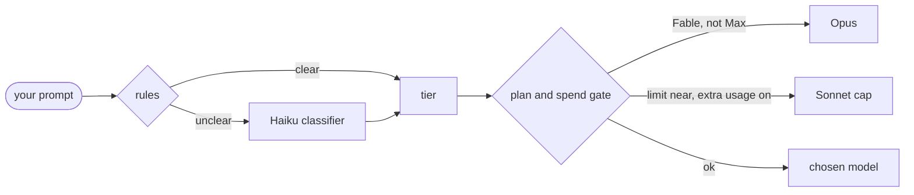

<p align="center"></p>

<p align="center">
  <a href="LICENSE"></a>
  
  
</p>

A collection of small mods for [Claude Code](https://claude.com/claude-code). Each mod is its own plugin, so you install only the ones you want.

Mods use Claude Code's hooks-module API, which is early access and may change between releases. They were built and tested on Claude Code 2.1.300.

## 🧩 Mods

| Mod | What it does |
| --- | --- |
| [autoroute](mods/autoroute) | Picks the model and effort for each prompt, sends subagents to cheaper models, and keeps Fable and extra-usage spend in check. |
| [box-tools](mods/box-tools) | A `[ Tools ]` button at the right end of the prompt footer. Click it for a small box where you switch the model, the effort, and each of your daymods on or off. |
| [pace-statusline](https://github.com/daydeda/claude-code-statusline) | A 4-line status line with limit bars, reset times and a pace prediction (`⚠ runs out today 4:19pm`) so you know before you hit the wall. Lives in its own repo. |

More mods will be added here as they are ready.

## 📦 Install

Add the marketplace once, then install any mod from it.

In a Claude Code session:

```
/plugin install autoroute --marketplace daydeda/daymods
```

Or from a shell:

```bash
claude plugin marketplace add daydeda/daymods
claude plugin install autoroute@daymods
claude plugin install box-tools@daymods
claude plugin install pace-statusline@daymods
```

Answer `y` when asked to add the marketplace and pick a scope. The mod is active right away. Mods installed at the user scope load in every later session.

To remove one: `claude plugin uninstall autoroute`.

## 🧭 autoroute

Routes each prompt to a suitable model and effort, so small jobs stop burning Opus tokens and big jobs get a plan.

<p align="center"></p>

### How it works

1. **Pick a route per prompt.** When you send a message, quick keyword and length rules choose a tier. If the rules cannot tell, a low-effort Haiku call decides. The choice is locked for the whole reply, so the prompt cache stays warm instead of being rebuilt on every step.

   | Tier | Typical prompts | Model | Effort |
   | --- | --- | --- | --- |
   | trivial | a question, typo, rename, quick lookup | Haiku | low |
   | normal | a feature or fix in 1-3 files | Sonnet | medium |
   | hard | tricky debugging, design, refactors | Opus | high |
   | large | migrations, rewrites, architecture | Opus | high, plus a delegation plan |

   Short follow-ups like "continue" or "yes" keep the previous route.

2. **Delegate large work.** For the large tier, autoroute tells the model to work as a pipeline: Explore subagents map the code, a plan is written to a file, then a Sonnet subagent implements it. Other tiers are told to work directly.

3. **Route subagents.** Explore agents run on Haiku at low effort, Plan agents on Opus, and any other subagent with no model set runs on Sonnet.



### Two spend rules

These apply to every request, whatever chose its model, and stay on even when routing is turned off.

- **Fable needs a Max plan.** autoroute reads your plan from the local Claude login record (`~/.claude.json`). Anything other than a Max plan, or a plan it cannot read, is downgraded from Fable to Opus. This covers the router, `!fable`, Fable picked in `/model`, and Fable subagents.
- **Spend guard.** If extra usage is switched on for your account and any limit window (5-hour or weekly) passes the threshold (90% by default), routes are capped at Sonnet and a warning shows in the status line.

The plan check reads a local file the user can edit. It prevents accidental charges; it is not a security boundary.

### Controls

- **Status line:** by default autoroute adds no row of its own. It writes the current route to `~/.claude/autoroute.state`, and a status line script can show it inline. [pace-statusline](https://github.com/daydeda/claude-code-statusline) does: `Opus ▶ high ⇢ Haiku·low ▶ ⌂ daymods`, plus a `⚠` note for downgrades or spend warnings. The `⇢` part is hidden once the running model matches the route. Set `display` to `line` to get autoroute's own row instead, for example `autoroute: Haiku · low · "typo" (rules)`.
- **Compact status line:** with pace-statusline, `STATUSLINE_COMPACT=1` folds ctx, 5-hour, weekly and session stats into one row with short bars. The reset countdown shows only past 50% used.
- **Override one prompt:** start a message with `!haiku`, `!sonnet`, `!opus`, `!fable` or `!max`. `!auto` routes normally.
- **`/route on|off|status`:** turn routing on or off, or show the last route, your plan, and the spend guard state.
- **Options** (in `/config`):
  - `classifier`: `rules+haiku` (default) or `rules` only. Rules-only makes no model call.
  - `display`: `statusline` (default) writes the route for your status line to show; `line` shows autoroute's own row.
  - `spendGuardPercent`: threshold for the spend guard, default `90`.

### Notes and limits

- The keyword rules are a starting point and will misjudge some prompts. Use `!` overrides, or `/route status` to see why a route was chosen.
- The model IDs are set in `mods/autoroute/hooks/route.ts`. If your Claude Code build uses different IDs, change them there.
- The Haiku classifier sends the start of your prompt (up to 4000 characters) to Haiku through your own Claude session. Nothing goes to any other service.

## 🧰 box-tools

A `[ Tools ]` button sits at the right end of the prompt footer. Click it and a small box opens beside the transcript:

```
✦ Tools                                       Opus · high
╭─────────────────────────────────────────────────────────╮
│ ◆  Model                                            1-5 │
│ 1: ○ Default 2: ○ Haiku 3: ○ Sonnet 4: ● Opus 5: ○ Fable │
╰─────────────────────────────────────────────────────────╯
╭─────────────────────────────────────────────────────────╮
│ ⚡ Effort                                    q w e r t │
│ q: ○ low  w: ○ medium  e: ● high  r: ○ xhigh  t: ○ max  │
╰─────────────────────────────────────────────────────────╯
╭─────────────────────────────────────────────────────────╮
│ ❖  Mods                                         a s d … │
│ a: ● on   autoroute                                     │
╰─────────────────────────────────────────────────────────╯
```

### Controls

- **Open:** click `[ Tools ]`, or run `/tools`. Clicking the button again closes the box.
- **Pick:** click a choice, press its hotkey, or Tab to it and press Enter. Hotkeys: `1`-`5` for models, `q` `w` `e` `r` `t` for effort, `a` `s` `d`… for mods.
- **Close:** Esc, a click anywhere outside the box (the transcript or the prompt), `x`, or the button again.

### What each control does

- **Model** sets the `model` row of `/config`, the same as picking it there. It becomes your default for new sessions too.
- **Effort** runs the built-in `/effort <level>`, as if you typed it. Claude Code saves the level for the current model, so it carries over to new sessions.
- **Mods** lists the daymods you have installed (Box Tools itself is left out). A toggle runs `claude plugin enable` or `claude plugin disable`, then `/reload-plugins`, so the change applies right away and stays on or off in later sessions.

### Notes and limits

- When **autoroute** is on, it picks the model and effort for each prompt and overrides what you pick here. The box says so. Turn autoroute off in the same box to keep your pick.
- A change made while Claude is working waits until the turn ends, the same as a typed command.
- Mods loaded with `--plugin-dir` aren't installed, so they don't appear in the list.
- **Options** (in `/config`): `button` (`show` or `hide`). With `hide`, the footer is left alone and `/tools` opens the box.

## 🛠 Development

Each mod lives in `mods/<name>/` with the standard layout:

```
mods/<name>/
├── .claude-plugin/plugin.json
├── hooks/hooks.json
├── hooks/register.ts
└── tests/
```

Check and test a mod with:

```bash
claude plugin validate mods/autoroute
claude plugin test mods/autoroute
```

Try one without installing it: `claude --plugin-dir mods/autoroute`.

## 📄 License

[MIT](LICENSE)
